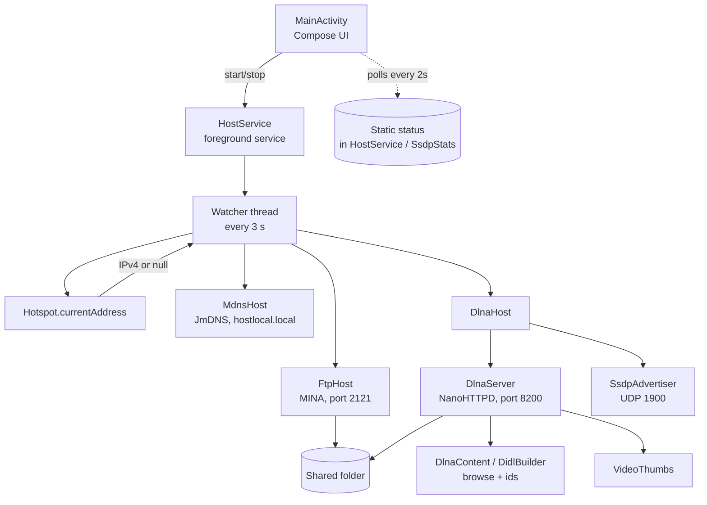

# Architecture overview

One foreground service owns three servers. A watcher inside the service decides **which network address** to serve on, and starts or restarts the servers whenever that changes.

## Request flow

1. The user taps **Start**. `MainActivity` calls `HostService.start()`, which starts a foreground service.
2. `HostService.onStartCommand` checks the shared folder exists, takes the Wi-Fi, multicast and wake locks, and starts the watcher.
3. Every 3 seconds the watcher calls `Hotspot.currentAddress()`. If the address changed, all servers stop and `boundIp` is updated.
4. For the current address, any server that is not running is started: FTP, mDNS, DLNA. Each retries on its own, so one failure doesn't restart the others.
5. The UI reads static status fields (`HostService.ftpAddress`, `SsdpStats`, ...) every 2 seconds and redraws.

## Key properties

- **Everything binds to one IP.** FTP and DLNA bind to the chosen interface address, not `0.0.0.0`, so nothing is exposed on mobile data.
- **Read-only.** FTP user has no write authority; DLNA only serves GET requests for video files under the root.
- **No persistent state** besides the folder path and a generated DLNA UUID (`SharedPreferences`).
- **Status is process-global.** The UI and service share state through `@Volatile` fields on companion objects. That is simple and fine for a single service, but it means there is exactly one server set per process.

## Threads

| Thread | Owner | Work |
|---|---|---|
| Main | Android | Compose UI, service callbacks |
| `pool-*` (single) | `HostService` | The 3-second watcher; starts and stops servers |
| MINA threads | `FtpHost` | FTP sessions |
| NanoHTTPD threads | `DlnaServer` | One per HTTP connection, including media streaming |
| `ssdp-listen` | `SsdpAdvertiser` | Blocks on UDP 1900, answers searches |
| `pool-*` (single) | `SsdpAdvertiser` | Announcements every 60 s |
| JmDNS threads | `MdnsHost` | mDNS responder |
| Cleanup executor | `HostService.onDestroy` | Stops servers off the main thread |

!!! warning
    `stopServers()` does network I/O. Never call it on the main thread.

## Package map

| Path | Role |
|---|---|
| `MainActivity.kt` | UI, permission requests, polling loop |
| `HostService.kt` | Lifecycle, locks, watcher, shared status |
| `Hotspot.kt` | Chooses the address to serve on |
| `FtpHost.kt` | FTP server wrapper |
| `MdnsHost.kt` | mDNS wrapper |
| `dlna/DlnaHost.kt` | Starts/stops HTTP + SSDP together |
| `dlna/DlnaServer.kt` | HTTP: descriptions, SOAP, streaming |
| `dlna/DlnaContent.kt` | Object ids, folder listing, Range parsing, DIDL-Lite |
| `dlna/DlnaDescriptions.kt` | Static UPnP XML |
| `dlna/Ssdp.kt` | SSDP messages and advertiser, `SsdpStats` |
| `VideoThumbs.kt` | JPEG thumbnails |
| `FolderPaths.kt` | SAF tree URI to filesystem path |
| `Settings.kt` | Prefs and constants |
